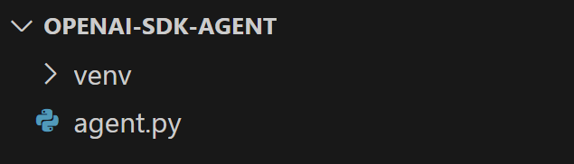
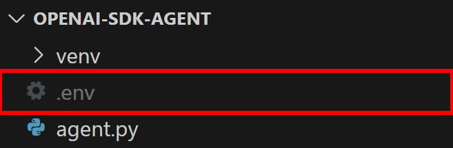
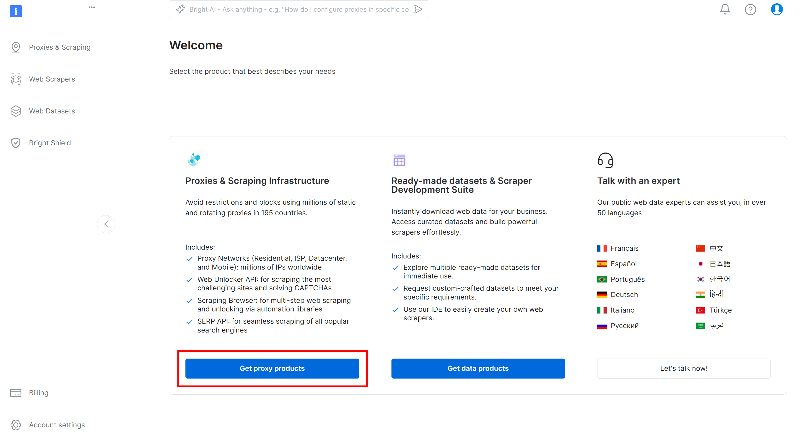
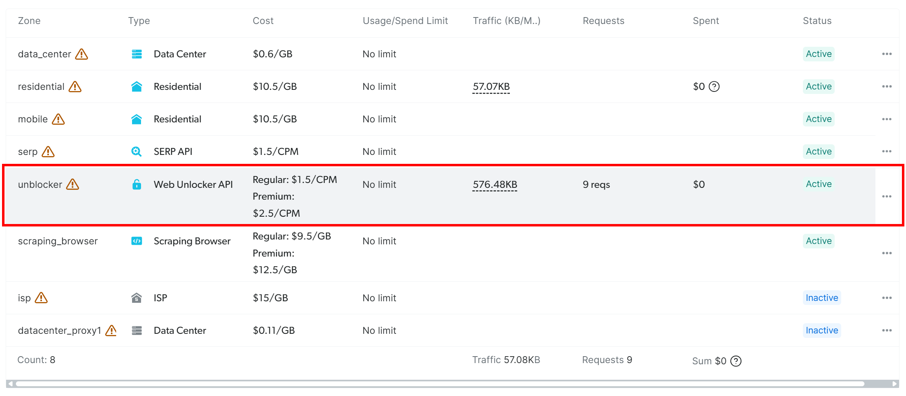
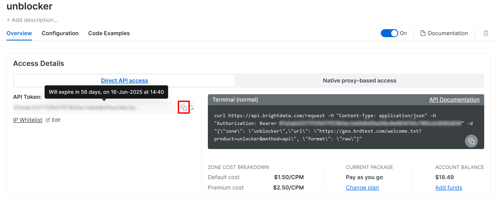
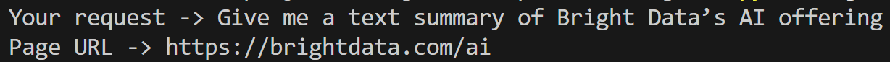
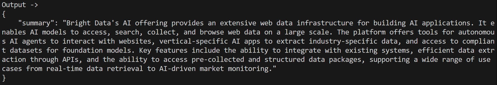
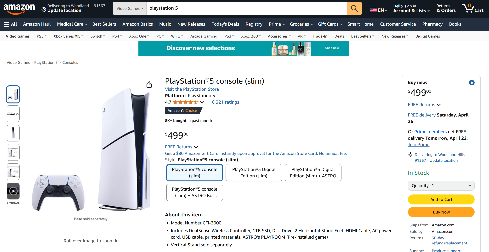
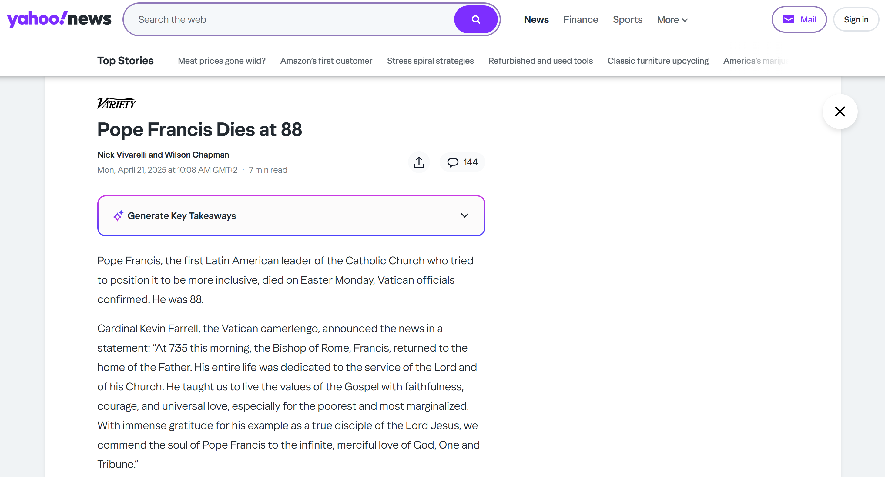

# 如何将 OpenAI 智能体 SDK 与网络解锁器集成以实现高性能

[](https://www.bright.cn/)

本指南介绍如何将 OpenAI 智能体 SDK 与网络解锁器 API 相结合，使用 Python 创建强大的 AI 智能体，以从网站检索和处理数据。

- [什么是 OpenAI 智能体 SDK？](#什么是-openai-智能体-sdk)
- [这种 AI 智能体方法面临的主要挑战](#这种-ai-智能体方法面临的主要挑战)
- [将智能体 SDK 与网络解锁器 API 集成](#将智能体-sdk-与网络解锁器-api-集成)
  - [步骤 1：项目设置](#步骤-1项目设置)
  - [步骤 2：安装项目依赖项并开始使用](#步骤-2安装项目依赖项并开始使用)
  - [步骤 3：设置环境变量读取](#步骤-3设置环境变量读取)
  - [步骤 4：设置 OpenAI 智能体 SDK](#步骤-4设置-openai-智能体-sdk)
  - [步骤 5：设置网络解锁器 API](#步骤-5设置网络解锁器-api)
  - [步骤 6：创建网页内容提取函数](#步骤-6创建网页内容提取函数)
  - [步骤 7：定义数据模型](#步骤-7定义数据模型)
  - [步骤 8：初始化智能体逻辑](#步骤-8初始化智能体逻辑)
  - [步骤 9：实现执行循环](#步骤-9实现执行循环)
  - [步骤 10：整合所有代码](#步骤-10整合所有代码)
  - [步骤 11：测试 AI 智能体](#步骤-11测试-ai-智能体)

## 什么是 OpenAI 智能体 SDK？

[OpenAI 智能体 SDK](https://openai.github.io/openai-agents-python/) 是 OpenAI 创建的开源 Python 库。它让开发者能够以简单、高效且可投入生产的方式构建基于智能体的 AI 应用程序。该库是 OpenAI 早期实验项目 [Swarm](https://github.com/openai/swarm) 的改进版本。

OpenAI 智能体 SDK 以极少的抽象提供了几个关键组件：

- **智能体**：与特定指令和工具相结合以执行任务的 LLM
- **移交**：让智能体能够在必要时将任务转交给其他智能体
- **护栏**：验证智能体输入，确保其符合预期格式或要求

这些核心元素与 Python 的灵活性相结合，有助于实现智能体与工具之间复杂的交互。

该 SDK 还内置了跟踪功能，让你可以直观查看、排查问题并评估智能体工作流。它甚至支持针对特定用例进行模型微调。

## 这种 AI 智能体方法面临的主要挑战

大多数 AI 智能体都旨在自动执行网页上的操作，无论是提取内容还是与页面元素交互。本质上，它们需要以编程方式浏览网页。

除了 AI 模型本身可能产生的误解外，这些智能体面临的最大[障碍](https://www.bright.cn/blog/web-data/anti-scraping-techniques)是应对网站的防御机制。这是因为许多网站都采用了反机器人和反爬虫技术，可能会限制或误导 AI 智能体。如今这一问题尤为突出，因为[反 AI 验证码和复杂的机器人检测系统正变得越来越普遍](https://hackernoon.com/ai-agent-browsers-are-failing-and-its-not-just-because-of-captchas)。

要克服这些障碍，你需要通过集成 [Bright Data 的网络解锁器 API](https://www.bright.cn/products/web-unlocker) 之类的解决方案来增强智能体的网页浏览能力。该工具适用于任何连接互联网的 HTTP 客户端或解决方案（包括 AI 智能体），并充当网页解锁网关。它可以从任何网页提供干净且未被拦截的 HTML，让你不再受验证码、IP 限制或内容无法访问等问题的困扰。

## 将智能体 SDK 与网络解锁器 API 集成

在本节的分步指导中，你将了解如何将 OpenAI 智能体 SDK 与 Bright Data 的网络解锁器 API 集成，从而构建能够执行以下任务的 AI 智能体：

1. 为任意网页中的文本生成摘要
2. 从电商网站获取结构化产品信息
3. 采集新闻文章中的关键信息

为此，智能体将指示 OpenAI 智能体 SDK 使用网络解锁器 API 获取任意网页的内容。获取内容后，智能体会应用 AI 逻辑，根据每项任务的要求提取并格式化数据。

> **免责声明**：
> 
> 上面提到的三个用例仅为示例。通过自定义智能体行为，此处介绍的方法可以扩展到许多其他场景。

按照以下说明，使用 OpenAI 智能体 SDK 和 Bright Data 网络解锁器 API 在 Python 中开发高性能 AI 爬虫智能体。

### 前提条件

开始本教程之前，请确保你已具备以下条件：

- 计算机上已安装 Python 3 或更高版本
- 有效的 Bright Data 账户
- 有效的 OpenAI 账户
- 对 HTTP 请求有基本了解
- 对 Pydantic 模型有一定了解
- 对 AI 智能体的工作方式有大致了解

### 步骤 1：项目设置

首先，确认你的系统已安装 Python 3。如果尚未安装，请[下载 Python](https://www.python.org/downloads/)，并按照适用于你的操作系统的安装说明操作。

启动终端，并为爬虫智能体项目创建一个新目录：

```sh
mkdir openai-sdk-agent
```

`openai-sdk-agent` 目录将存放基于 Python 并由智能体 SDK 驱动的智能体全部代码。

进入项目目录并创建一个[虚拟环境](https://docs.python.org/3/library/venv.html)：

```sh
cd openai-sdk-agent
python -m venv venv
```

使用你偏好的 Python IDE 打开项目目录。[安装了 Python 扩展的 Visual Studio Code](https://code.visualstudio.com/docs/languages/python) 或 [PyCharm Community Edition](https://www.jetbrains.com/pycharm/download/#section=windows) 都是不错的选择。

在 `openai-sdk-agent` 目录中，创建一个名为 `agent.py` 的新 Python 文件。此时，你的目录结构应如下所示：



目前，`scraper.py` 还是一个空的 Python 脚本，但它很快就会包含所需的 AI 智能体逻辑。

在 IDE 的终端中激活虚拟环境。对于 Linux 或 macOS，请执行以下命令：

```sh
./env/bin/activate
```

同样，在 Windows 上运行：

```powershell
env/Scripts/activate
```

### 步骤 2：安装项目依赖项并开始使用

本项目使用以下 Python 库：

- [`openai-agents`](https://openai.github.io/openai-agents-python/)：OpenAI 智能体 SDK，用于在 Python 中创建 AI 智能体。
- [`requests`](https://requests.readthedocs.io/en/latest/)：用于连接 Bright Data 的网络解锁器 API，并检索网页的 HTML 内容以供 AI 智能体处理。有关更多信息，请参阅我们的[全面掌握 Python Requests 库](https://www.bright.cn/blog/web-data/python-requests-guide)指南。
- [`pydantic`](https://docs.pydantic.dev/latest/)：用于定义结构化输出模型，使智能体能够以清晰且经过验证的格式返回数据。
- [`markdownify`](https://python.langchain.com/docs/integrations/document_transformers/markdownify/)：用于将原始 HTML 内容转换为简洁的 Markdown。（我们稍后会解释这样做的优势。）
- [`python-dotenv`](https://github.com/theskumar/python-dotenv)：用于从 `.env` 文件加载环境变量。我们会在其中存储 OpenAI 和 Bright Data 的凭据。

在已激活的虚拟环境中，使用以下命令安装所有依赖项：

```sh
pip install requests pydantic openai-agents openai-agents markdownify python-dotenv
```

现在，使用以下导入和异步样板代码设置 `scraper.py`：

```python
import asyncio
from agents import Agent, RunResult, Runner, function_tool
import requests
from pydantic import BaseModel
from markdownify import markdownify as md
from dotenv import load_dotenv 

# AI agent logic...

async def run():
    # Call the async AI agent logic...

if __name__ == "__main__":
    asyncio.run(run())
```

### 步骤 3：设置环境变量读取

在项目目录中创建一个 `.env` 文件：



该文件将存储 API 密钥和秘密令牌等环境变量。要从 `.env` 文件加载环境变量，请使用 `dotenv` 软件包中的 `load_dotenv()`：

```python
load_dotenv()
```

现在，你可以使用 [`os.getenv()`](https://docs.python.org/3/library/os.html#os.getenv) 访问特定的环境变量，如下所示：

```python
os.getenv("ENV_NAME")
```

请记得从 Python 标准库导入 [`os`](https://docs.python.org/3/library/os.html)：

```python
import os
```

### 步骤 4：设置 OpenAI 智能体 SDK

你需要有效的 OpenAI API 密钥才能使用 OpenAI 智能体 SDK。如果尚未生成，请按照 [OpenAI 官方指南](https://help.openai.com/en/articles/4936850-where-do-i-find-my-openai-api-key)创建 API 密钥。

获取密钥后，将其添加到 `.env` 文件中，如下所示：

```python
OPENAI_API_KEY="<YOUR_OPENAI_KEY>"
```

请务必将 `<YOUR_OPENAI_KEY>` 占位符替换为你的实际密钥。

无需进行其他设置，因为 `openai-agents` SDK 会自动从 `OPENAI_API_KEY` 环境变量中获取 API 密钥。

### 步骤 5：设置网络解锁器 API

如果你还没有账户，请[创建 Bright Data 账户](https://www.bright.cn/?hs_signup=1)。否则，只需[登录。](https://www.bright.cn/cp/start)

接下来，查阅 [Bright Data 官方网络解锁器文档](https://docs.brightdata.com/scraping-automation/web-unlocker/quickstart)以获取 API 令牌。你也可以按照以下步骤操作。

在 Bright Data 的“用户控制面板”页面中，选择“获取代理产品”选项：



在产品表格中，找到标有“解锁器”的行并点击：



在“解锁器”页面上，使用剪贴板图标复制你的 API 令牌：



此外，请确认右上角的开关已切换至“开启”，这表示网络解锁器产品处于启用状态。

在“配置”选项卡下，请确保启用以下选项，以获得最佳效果：

- [高级域名](https://docs.brightdata.com/scraping-automation/web-unlocker/configuration#premium-domains)
- [验证码破解](https://www.bright.cn/products/web-unlocker/captcha-solver)


在 `.env` 文件中添加此环境变量：

```python
BRIGHT_DATA_WEB_UNLOCKER_API_TOKEN="<YOUR_BRIGHT_DATA_WEB_UNLOCKER_API_TOKEN>"
```

将占位符替换为你的实际 API 令牌。

### 步骤 6：创建网页内容提取函数

创建一个 `get_page_content()` 函数，用于：

1. 读取 `BRIGHT_DATA_WEB_UNLOCKER_API_TOKEN` 环境变量
2. 使用 `requests`，[通过提供的 URL 向 Bright Data 的网络解锁器 API 发送请求](https://docs.brightdata.com/scraping-automation/web-unlocker/send-your-first-request)
3. 检索 API 返回的原始 HTML
4. 将 HTML 转换为 Markdown 并返回

按如下方式实现上述逻辑：

```python
@function_tool
def get_page_content(url: str) -> str:
    """
    Retrieves the HTML content of a given web page using Bright Data's Web Unlocker API,
    bypassing anti-bot protections. The response is converted from raw HTML to Markdown
    for easier and cheaper processing.

    Args:
        url (str): The URL of the web page to scrape.

    Returns:
        str: The Markdown-formatted content of the requested page.
    """

    # Read the Bright Data's Web Unlocker API token from the envs
    BRIGHT_DATA_WEB_UNLOCKER_API_TOKEN = os.getenv("BRIGHT_DATA_WEB_UNLOCKER_API_TOKEN")

    # Configure the Web Unlocker API call
    api_url = "https://api.brightdata.com/request"
    headers = {
        "Content-Type": "application/json",
        "Authorization": f"Bearer {BRIGHT_DATA_WEB_UNLOCKER_API_TOKEN}"
    }
    data = {
        "zone": "unblocker",
        "url": url,
        "format": "raw"
    }

    # Make the call to Web Uncloker to retrieve the unblocked HTML of the target page
    response = requests.post(api_url, headers=headers, data=json.dumps(data))

    # Extract the raw HTML response
    html = response.text

    # Convert the HTML to markdown and return it
    markdown_text = md(html)

    return markdown_text
```

**注意 1**：该函数必须使用 [`@function_tool`](https://openai.github.io/openai-agents-python/tools/) 进行注解。这个特殊装饰器会通知 OpenAI 智能体 SDK，该函数可作为工具供智能体执行特定操作。在此例中，该函数充当智能体可用来检索待处理网页内容的“引擎”。

**注意 2**：`get_page_content()` 函数必须明确声明输入类型。  
如果省略这些类型，你将遇到如下错误：`Error getting response: Error code: 400 - {'error': {'message': "Invalid schema for function 'get_page_content': In context=('properties', 'url'), schema must have a 'type' key.``"`

将原始 HTML 转换为 Markdown 可以提高性能和成本效益，因为 HTML 非常冗长，并且通常包含脚本、样式和元数据等不必要的元素。AI 智能体并不需要这些内容。如果你的智能体只需要文本、链接和图像等基本信息，Markdown 可以提供更加简洁紧凑的表示形式。

具体而言，将 HTML 转换为 Markdown 最多可将输入大小减少 99%，从而节省：

- Token，降低使用 OpenAI 模型时的成本
- 处理时间，因为模型处理较小输入的速度更快

如需了解更多信息，请阅读文章“[为什么新的 AI 智能体更青睐 Markdown 而不是 HTML？](https://hackernoon.com/why-are-the-new-ai-agents-choosing-markdown-over-html)”

### 步骤 7：定义数据模型

为了正常运行，OpenAI SDK 智能体需要使用 Pydantic 模型来定义其预期输出数据的结构。请记住，我们正在构建的智能体可能返回以下三种输出之一：

1.  页面摘要
2.  产品信息
3.  新闻文章信息

下面定义三个对应的 [Pydantic 模型](https://docs.pydantic.dev/latest/concepts/models/)：

```python
class Summary(BaseModel):
    summary: str

class Product(BaseModel):
    name: str
    price: Optional[float] = None
    currency: Optional[str] = None
    ratings: Optional[int] = None
    rating_score: Optional[float] = None

class News(BaseModel):
    title: str
    subtitle: Optional[str] = None
    authors: Optional[List[str]] = None
    text: str
    publication_date: Optional[str] = None
```

**注意**：使用 `Optional` 可以让你的智能体更加灵活且更具通用性。并非所有页面都会包含架构中定义的每一项数据，因此这种灵活性有助于避免因字段缺失而发生错误。

别忘了从 [`typing`](https://docs.python.org/3/library/typing.html) 导入 `Optional` 和 `List`：

```python
from typing import Optional, List
```

### 步骤 8：初始化智能体逻辑

使用 `openai-agents` SDK 中的 [`Agent`](https://platform.openai.com/docs/guides/agents) 类定义三个专用智能体：

```python
summarization_agent = Agent(
    name="Text Summarization Agent",
    instructions="You are a content summarization agent that summarizes the input text.",
    tools=[get_page_content],
    output_type=Summary,
)

product_info_agent = Agent(
    name="Product Information Agent",
    instructions="You are a product parsing agent that extracts product details from text.",
    tools=[get_page_content],
    output_type=Product,
)

news_info_agent = Agent(
    name="News Information Agent",
    instructions="You are a news parsing agent that extracts relevant news details from text.",
    tools=[get_page_content],
    output_type=News,
)
```

每个智能体：

1. 包含清晰的指令字符串，用于描述其预期功能。OpenAI 智能体 SDK 使用该字符串来指导智能体的行为。
2. 使用 `get_page_content()` 作为工具来检索输入数据（即网页内容）。
3. 使用之前定义的 Pydantic 模型（`Summary`、`Product` 或 `News`）之一返回输出。

要将用户请求自动转发至合适的专用智能体，请定义一个更高层级的智能体：

```python
routing_agent = Agent(
    name="Routing Agent",
    instructions=(
        "You are a high-level decision-making agent. Based on the user's request, "
        "hand off the task to the appropriate agent."
    ),
    handoffs=[summarization_agent, product_info_agent, news_info_agent],
) 
```

你将在 `run()` 函数中查询此智能体，以驱动 AI 智能体逻辑。

### 步骤 9：实现执行循环

在 `run()` 函数中添加以下循环，以启动 AI 智能体逻辑：

```python
# Keep iterating until the use type "exit"
while True:
    # Read the user's request
    request = input("Your request -> ")
    # Stops the execution if the user types "exit"
    if request.lower() in ["exit"]:
        print("Exiting the agent...")
        break
    # Read the page URL to operate on
    url = input("Page URL -> ")

    # Routing the user's request to the right agent
    output = await Runner.run(routing_agent, input=f"{request} {url}")
    # Conver the agent's output to a JSON string
    json_output = json.dumps(output.final_output.model_dump(), indent=4)
    print(f"Output -> \n{json_output}\n\n")
```

该循环会持续监测用户输入，并通过将每个请求路由至合适的智能体（摘要、产品或新闻）来进行处理。它会将用户查询与目标 URL 结合，执行相应逻辑，然后使用 [`json`](https://docs.python.org/3/library/json.html) 以 JSON 格式显示结构化结果。使用以下代码导入它：

```python
import json
```

### 步骤 10：整合所有代码

现在，你的 `scraper.py` 文件应包含：

```python
import asyncio
from agents import Agent, RunResult, Runner, function_tool
import requests
from pydantic import BaseModel
from markdownify import markdownify as md
from dotenv import load_dotenv
import os
from typing import Optional, List
import json

# Load the environment variables from the .env file
load_dotenv()

# Define the Pydantic output models for your AI agent
class Summary(BaseModel):
    summary: str

class Product(BaseModel):
    name: str
    price: Optional[float] = None
    currency: Optional[str] = None
    ratings: Optional[int] = None
    rating_score: Optional[float] = None

class News(BaseModel):
    title: str
    subtitle: Optional[str] = None
    authors: Optional[List[str]] = None
    text: str
    publication_date: Optional[str] = None

@function_tool
def get_page_content(url: str) -> str:
    """
    Retrieves the HTML content of a given web page using Bright Data's Web Unlocker API,
    bypassing anti-bot protections. The response is converted from raw HTML to Markdown
    for easier and cheaper processing.

    Args:
        url (str): The URL of the web page to scrape.

    Returns:
        str: The Markdown-formatted content of the requested page.
    """

    # Read the Bright Data's Web Unlocker API token from the envs
    BRIGHT_DATA_WEB_UNLOCKER_API_TOKEN = os.getenv("BRIGHT_DATA_WEB_UNLOCKER_API_TOKEN")

    # Configure the Web Unlocker API call
    api_url = "https://api.brightdata.com/request"
    headers = {
        "Content-Type": "application/json",
        "Authorization": f"Bearer {BRIGHT_DATA_WEB_UNLOCKER_API_TOKEN}"
    }
    data = {
        "zone": "unblocker",
        "url": url,
        "format": "raw"
    }

    # Make the call to Web Uncloker to retrieve the unblocked HTML of the target page
    response = requests.post(api_url, headers=headers, data=json.dumps(data))

    # Extract the raw HTML response
    html = response.text

    # Convert the HTML to markdown and return it
    markdown_text = md(html)

    return markdown_text

# Define the individual OpenAI agents
summarization_agent = Agent(
    name="Text Summarization Agent",
    instructions="You are a content summarization agent that summarizes the input text.",
    tools=[get_page_content],
    output_type=Summary,
)

product_info_agent = Agent(
    name="Product Information Agent",
    instructions="You are a product parsing agent that extracts product details from text.",
    tools=[get_page_content],
    output_type=Product,
)

news_info_agent = Agent(
    name="News Information Agent",
    instructions="You are a news parsing agent that extracts relevant news details from text.",
    tools=[get_page_content],
    output_type=News,
)

# Define a high-level routing agent that delegates tasks to the appropriate specialized agent
routing_agent = Agent(
    name="Routing Agent",
    instructions=(
        "You are a high-level decision-making agent. Based on the user's request, "
        "hand off the task to the appropriate agent."
    ),
    handoffs=[summarization_agent, product_info_agent, news_info_agent],
)

async def run():
    # Keep iterating until the use type "exit"
    while True:
        # Read the user's request
        request = input("Your request -> ")
        # Stops the execution if the user types "exit"
        if request.lower() in ["exit"]:
            print("Exiting the agent...")
            break
        # Read the page URL to operate on
        url = input("Page URL -> ")

        # Routing the user's request to the right agent
        output = await Runner.run(routing_agent, input=f"{request} {url}")
        # Conver the agent's output to a JSON string
        json_output = json.dumps(output.final_output.model_dump(), indent=4)
        print(f"Output -> \n{json_output}\n\n")


if __name__ == "__main__":
    asyncio.run(run())
```

### 步骤 11：测试 AI 智能体

要启动 AI 智能体，请执行：

```sh
python agent.py
```

假设你想要总结 [Bright Data AI 服务中心](https://www.bright.cn/ai)的内容。只需输入如下请求：



你将收到以下 JSON 格式的结果：



现在，假设你想从 Amazon 产品页面提取产品数据，例如 [PS5 商品页面](https://www.amazon.com/PlayStation%C2%AE5-console-slim-PlayStation-5/dp/B0CL61F39H/)：



通常，[Amazon 的 CAPTCHA 和反机器人系统](https://www.bright.cn/blog/web-data/bypass-amazon-captcha)会拦截你的请求。借助网络解锁器 API，你的 AI 智能体可以访问和分析该页面，而不会被拦截：


输出如下：

```json
{
    "name": "PlayStation\u00ae5 console (slim)",
    "price": 499.0,
    "currency": "USD",
    "ratings": 6321,
    "rating_score": 4.7
}
```

最后，假设你想从[一篇 Yahoo 新闻文章](https://www.yahoo.com/news/pope-francis-dies-88-080859417.html)中获取结构化新闻信息：



使用以下输入即可完成：

```
Your request -> Give me news info
Page URL -> https://www.yahoo.com/news/pope-francis-dies-88-080859417.html
```

结果如下：

```json
{
    "title": "Pope Francis Dies at 88",
    "subtitle": null,
    "authors": [
        "Nick Vivarelli",
        "Wilson Chapman"
    ],
    "text": "Pope Francis, the 266th Catholic Church leader who tried to position the church to be more inclusive, died on Easter Monday, Vatican officials confirmed. He was 88. (omitted for brevity...)",
    "publication_date": "Mon, April 21, 2025 at 8:08 AM UTC"
}
```

## 总结

将 OpenAI SDK 与 Bright Data 的[网络解锁器 API](https://www.bright.cn/products/web-unlocker) 相结合，你就能开发可在几乎任何网页上可靠运行的 AI 智能体。这只是 Bright Data 产品和服务支持高级 AI 集成的一个示例。

探索我们完整的 [AI 产品](https://www.bright.cn/ai)系列：自主 AI 智能体、垂直 AI 应用、基础模型、多模态 AI、数据提供商、数据包等。

立即创建 Bright Data 账户，试用我们面向 AI 智能体开发的所有产品和服务！
